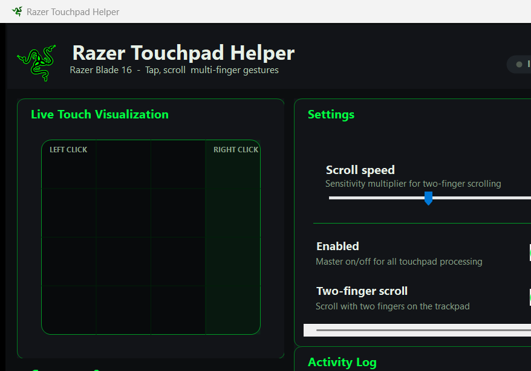

# Razer Touchpad Helper

A small, reversible Windows tray app that restores comfortable touchpad input on
Razer laptops: taps as clicks, two-finger scrolling, and multi-finger gestures.
It runs entirely in userspace — **no drivers, no registry tweaks, no admin** —
and everything it creates lives under `%USERPROFILE%\razer-touchpad-helper`.



## Why

On some Razer Blade units the precision touchpad stops delivering taps and
gestures even though the surface still reports touch contacts. Razer Touchpad
Helper listens to the pad's Raw Input vendor report and translates those
contacts back into normal mouse clicks, wheel scrolls and Windows hotkeys.

## Gestures

| Input | Action |
| --- | --- |
| 1-finger tap | Left click |
| 1-finger tap in the right zone | Right click |
| 1-finger long-press, then move | Drag (left button held) |
| Double-tap, then move | Drag |
| 2-finger tap | Right click |
| 2-finger move | Scroll (with optional cursor freeze) |
| 3-finger swipe up / down | Task View / Show desktop |
| 3-finger swipe left / right | Previous / next app |
| 3-finger tap | Search |
| 4-finger swipe up / down | Task View / Show desktop |
| 4-finger swipe left / right | Previous / next virtual desktop |
| 4-finger tap | Notifications |

The right-click zone width, swipe threshold, tap timing, scroll speed, drag
delay and more are all adjustable in the settings window.

## Features

- **Live visualizer** for contacts, last gesture and event counters.
- **Activity log** so you can see exactly what is being injected.
- **Settings window** with sliders and toggles — every change applies instantly
  and is saved automatically.
- **System tray first**: closing the window hides it to the notification area.
  Right-click the tray icon to open settings, toggle features, or exit.

## Requirements

- Windows 10 or 11 (x64)
- [.NET 8 SDK](https://dotnet.microsoft.com/download/dotnet/8.0) to build

## Build and run

```powershell
cd "C:\projects\razer-touchpad-helper\fix\Razer Touchpad Helper"
dotnet build -c Release

# Start hidden in the tray
Start-Process ".\bin\Release\net8.0-windows\Razer Touchpad Helper.exe" -ArgumentList '--tray'

# Or start with the window visible
Start-Process ".\bin\Release\net8.0-windows\Razer Touchpad Helper.exe"
```

## Autostart / rollback

```powershell
cd C:\projects\razer-touchpad-helper\fix\autostart
.\install.ps1   # Scheduled Task at logon, starts hidden in the tray
.\remove.ps1    # removes the task/shortcut, stops the helper, restores pointer speed
```

`install.ps1` prefers a per-user Scheduled Task and falls back to a Startup
folder shortcut if the task cannot be created. `remove.ps1` fully reverses it,
including cleaning up entries left by older versions of this helper.

## Settings and logs

| What | Where |
| --- | --- |
| Settings | `%USERPROFILE%\razer-touchpad-helper\logs\razer-touchpad-helper-settings.json` |
| Logs | `%USERPROFILE%\razer-touchpad-helper\logs\razer-touchpad-helper-<timestamp>.log` |
| Source | `C:\projects\razer-touchpad-helper` |

Settings persist across restarts and reboots. Close hides the window; use the
tray menu's **Exit** to quit the helper for real.

## Notes

- Only touch contacts are used for clicks; the physical button bit is ignored.
- A low-level mouse hook freezes the cursor while two or more fingers are down,
  so scrolling never moves the pointer unexpectedly.
- Nothing is installed system-wide and no drivers or registry values are changed.
